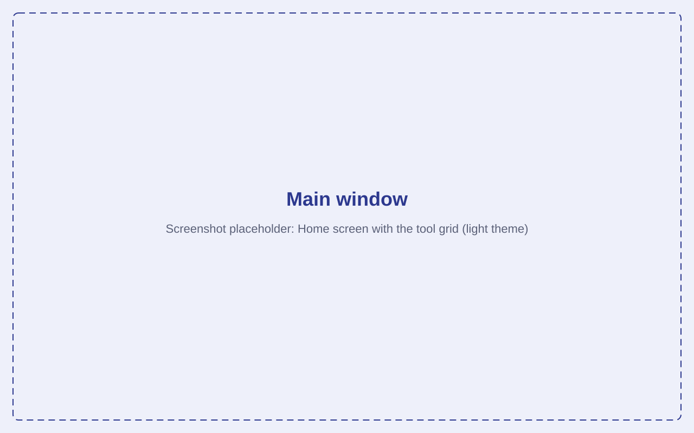
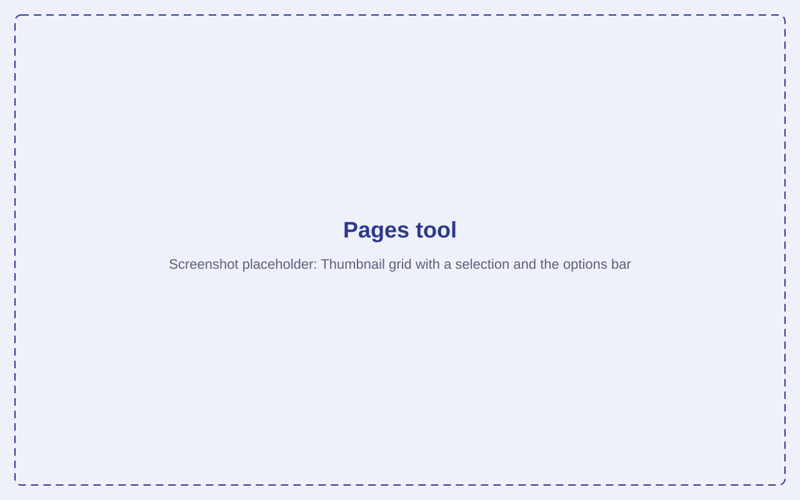
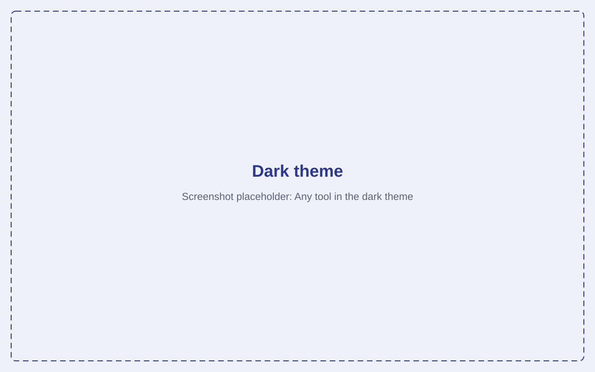

  

<h1 align="center">JJ PDF Studio</h1>

Free, offline PDF tools for Windows.

  <!-- TODO: replace OWNER/REPO once the GitHub repository exists -->
  
  
  

<!-- The images are placeholders; see docs/screenshots/README.md for how to replace them. -->

  

## Features

**Organise**

- **Merge** several PDFs into one, with optional bookmarks
- **Pages**: reorder, rotate, delete and insert blank pages, with undo and redo
- **Split** a PDF by page count, ranges or markers
- **Extract** selected pages
- **Rotate** all or some pages, losslessly

**Convert**

- **Images to PDF** (JPG, PNG, BMP, GIF, TIFF, WebP)
- **PDF to Images** (PNG or JPG, to a folder or a ZIP file)

**Optimise**

- **Resize** pages to A4, Letter and other sizes
- **Compress** to shrink file size (lossless, balanced or strong)

**Security**

- **Unlock**: remove an open password or restrictions
- **Protect**: lock a PDF with a password (AES-256)

**Edit**

- **Page numbers**, **Watermark** (text or picture) and **Properties** (metadata)

Every long job shows a progress bar with a **Cancel** button (or press Esc). Press **F1** in the
app for the keyboard shortcuts.

## Download

TODO: link to the latest release once v1.0.0 is published.

- **Portable exe** (`JJPDFStudio-<version>-portable.exe`): double-click to run, no installation.
- **Installer** (`JJPDFStudio-<version>-setup.exe`): optional, for people who prefer one.

**Requirements:** Windows 10 (1809 or later) or Windows 11, x64. The Microsoft WebView2 runtime
is required; it is already present on Windows 11 and on up-to-date Windows 10.

**SmartScreen:** until releases are code-signed, Windows may show "Windows protected your PC" on
first run. Choose **More info**, then **Run anyway**. You can verify the download against the
SHA-256 checksums published with each release.

## Privacy

- Fully offline: no network calls, no telemetry, no update pings.
- Your files never leave your computer.
- Originals are never overwritten; every operation saves a new file.

## Usage

1. Pick a tool in the sidebar, or drop a PDF anywhere on the window.
2. Make your changes. Nothing is written until you save.
3. Press **Save** (Ctrl+S) and choose a file name. The original is never overwritten.
4. Use **Open file** or **Show in folder** in the message that appears.

  
  

## Limitations

TODO: fill in as the tools land. Known from the plan: compression only recompresses common image
types and leaves fonts alone; password-protected PDFs are not supported yet; form fields may not
stay interactive after merging or resizing.

- **Resize** moves links and comments with the page, but links that point to a position inside the
  document keep their old coordinates. In "Change page size only" mode, content larger than the new
  page is cropped by the page edge.
- **Images to PDF** reads JPG, PNG, BMP, GIF (first frame), TIFF (first page) and WebP. CMYK and
  other unusual encodings are not tested and may be refused with a "could not be read" message.

- **Compress** only recompresses images it fully understands: JPEG and Flate images in RGB or
  gray (8 bits per channel), with or without a soft mask. JBIG2, JPEG 2000, CCITT, CMYK, indexed
  colour, images with a Decode array or colour-key mask, and inline images are left as they are.
  Fonts are not subset or removed, so text-only and vector PDFs shrink little. If the result is
  not smaller, no file is written and the original should be kept. Recompressing images is lossy;
  use **Lossless** if nothing may change.

## Compression results

Run `cargo run --release -p pdf-core --example bench_compress` to reproduce. The example builds
three kinds of PDF in memory, so the numbers show how each preset behaves, not what a particular
real-world file will do. Photos and scans in the wild vary a lot; the generated pictures are
smoother and larger than most, which exaggerates the savings of Balanced and Strong.

| Document                                   | Original | Lossless       | Balanced       | Strong          |
| ------------------------------------------ | -------- | -------------- | -------------- | --------------- |
| Scan, 8 pages, JPEG 300 DPI                | 17.11 MB | 17.11 MB (-0%) | 2.14 MB (-87%) | 0.91 MB (-95%)  |
| Office report, 10 pages, 2 photos per page | 73.36 MB | 73.36 MB (-0%) | 0.63 MB (-99%) | 0.20 MB (-100%) |
| Text only, 100 pages, uncompressed         | 0.50 MB  | 0.04 MB (-93%) | 0.04 MB (-93%) | 0.04 MB (-93%)  |
| Text only, 100 pages, already Flate        | 0.05 MB  | 0.04 MB (-24%) | 0.04 MB (-24%) | 0.04 MB (-24%)  |

Lossless saves nothing on files whose size is mostly already-compressed images, and a lot on files
written without stream compression. Balanced and Strong only change images drawn above 200 and
150 DPI.

## Building from source

See [CONTRIBUTING.md](CONTRIBUTING.md).

## Roadmap

TODO: link to the milestones / GitHub Projects board.

## License

Code: [Apache-2.0](LICENSE). The JJ name and logo are not covered by that license; see
[TRADEMARKS.md](TRADEMARKS.md) and [assets/brand/LICENSE.md](assets/brand/LICENSE.md).

Third-party licenses: see [THIRD_PARTY_NOTICES.md](THIRD_PARTY_NOTICES.md), also shown in the app
under **About**. Regenerate it with `npm run notices` after changing dependencies.

Made by James & James LLP.
